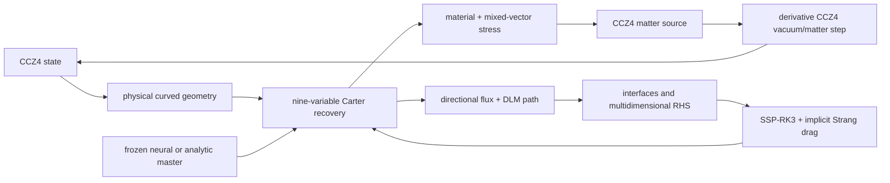

# Vulkan Tesseract

**Turn your gaming PC into a neural spacetime simulator.**

Vulkan Tesseract is a standalone GPU-resident Carter/CCZ4 simulation project
built with Slang, Vulkan, and a float64 Python reference engine. It combines
hard neural constitutive switching, relativistic two-current matter,
mixed-vector stress, multidimensional conservative transport, implicit
counterflow drag, and dynamical spacetime geometry.


The underlying construction began with

\[
a\oplus b=\frac32(a+b),
\]

then grew through a parity-gated recurrence, exact bounded KKT solves, Carter
master-function structure, differentiable hard decisions, learned
constitutive response, and finally a coupled numerical-relativity PDE solver.
This repository focuses on the Vulkan execution of that full stack.

## Current GPU milestone

The resident multidimensional engine advances:

- the curved nine-variable Carter primitive block
  `(log n, s, q_N^i, log d, q_D^i)`;
- the eleven-component conserved block
  `(D_N, D_D, S_i, E, P_i^D, D_N s, D_N Y)`;
- analytic-M1 or digest-locked frozen-neural constitutive response;
- mixed massive-vector energy, momentum, and spatial stress;
- directional Carter fluxes and the nonconservative DLM path contribution;
- implicit entropy-producing three-component counterflow drag;
- the packed 31-component CCZ4 geometry and gauge state; and
- the derivative-containing CCZ4 vacuum and recovered matter-source terms.

One coupled step uses:

1. a projected CCZ4 SSP-RK3 half-step;
2. an implicit Carter drag half-step;
3. multidirectional Carter SSP-RK3 transport;
4. a second implicit drag half-step; and
5. a projected CCZ4 SSP-RK3 half-step.

All stage recovery, constitutive decisions, stress evaluation, interface/RHS
assembly, source solves, and geometry derivatives execute on Vulkan. Python
initializes the run, submits kernels, and performs explicit qualification
readbacks.

## Qualified result

The tracked `8 x 8` frozen-neural campaign reports:

| Quantity | Result |
|---|---:|
| CCZ4 vacuum RHS maximum CPU/GPU error | `2.325e-6` |
| CCZ4 vacuum RHS RMS CPU/GPU error | `2.295e-7` |
| Final curved recovery residual | `4.303e-7` |
| Invalid recoveries | `0` |
| Baryon balance error | `7.217e-7` |
| Carrier balance error | `9.979e-7` |
| Tracer balance error | `7.334e-7` |
| Entropy change | `+1.942e-5` |
| Projected determinant residual | `0` |
| Projected trace-`A` residual | `7.276e-12` |
| Host readbacks during evolution | `0` |

The independent oracle evaluates the same projected float32 state with the
float64 CPU CCZ4 implementation, isolating the device operator from input
roundoff and algebraic projection differences.

See the
[multidimensional evolution report](VULKAN_MULTIDIMENSIONAL_EVOLUTION_REPORT.md)
and tracked
[qualification record](vulkan_multidimensional_results.json).

## Quick start

Vulkan Tesseract currently targets Windows PowerShell and a Vulkan-capable
GPU.

Create the shader environment:

```powershell
python -m venv .venv-slang
.\.venv-slang\Scripts\python.exe -m pip install -r requirements-slang.txt
```

Run the end-to-end multidimensional qualification:

```powershell
.\run_vulkan_multidimensional.ps1
```

Run the short live regression:

```powershell
.\.venv-slang\Scripts\python.exe .\test_vulkan_multidimensional.py
```

Run the visualization dashboard:

```powershell
.\run_visualization.ps1
```

## Vulkan qualification ladder

Each stage has a runnable campaign, tracked JSON evidence, and a focused
report.

| Stage | Command | Report |
|---|---|---|
| Resident analytic-M1 material slice | `.\run_vulkan_theory33.ps1` | [Theory 3.3 port](VULKAN_THEORY33_PORT_REPORT.md) |
| Frozen-neural hard phase tape | `.\run_vulkan_frozen_neural.ps1` | [Frozen-neural port](VULKAN_FROZEN_NEURAL_PORT_REPORT.md) |
| WENO5-Z and positivity limiting | `.\run_vulkan_weno.ps1` | [WENO port](VULKAN_WENO_PORT_REPORT.md) |
| Numerical Carter characteristic basis | `.\run_vulkan_carter_eigensystem.ps1` | [Carter eigensystem](VULKAN_CARTER_EIGENSYSTEM_REPORT.md) |
| Mixed sources, full Carter block, CCZ4 geometry | `.\run_vulkan_full_carter_ccz4.ps1` | [Full Carter/CCZ4](VULKAN_FULL_CARTER_CCZ4_REPORT.md) |
| Coupled multidimensional evolution | `.\run_vulkan_multidimensional.ps1` | [Multidimensional evolution](VULKAN_MULTIDIMENSIONAL_EVOLUTION_REPORT.md) |

The progression reports retain the boundary of each experiment and point to
the later stage that crossed it.

## Architecture



The two engines have distinct roles:

- `tesseract_nr_gpu.slang` and `tesseract_nr/vulkan_backend.py` implement the
  resident float32 production path.
- `tesseract_nr/` provides the transparent float64 oracle used for derivative,
  recovery, eigensystem, conservation, and continuum audits.

Flattened Vulkan grids use x-fastest indexing. One-, two-, and
three-dimensional periodic domains share the same shader ABI; inactive
directions contribute exactly zero transport and derivative terms.

See [architecture](docs/ARCHITECTURE.md) and
[CPU oracle contract](docs/NR_PDE_SOLVER.md).

## Repository guide

| Path | Purpose |
|---|---|
| `tesseract_nr_gpu.slang` | Resident Carter recovery, transport, sources, eigensystems, and CCZ4 kernels |
| `tesseract_nr/vulkan_backend.py` | Vulkan buffers, ABI, dispatch, splitting, and snapshots |
| `tesseract_nr/vulkan_validation.py` | Independent CPU/Vulkan qualification campaigns |
| `theory33_qualified_frozen.slang` | Generated digest-locked constitutive module |
| `theory33_frozen_variants.json` | Replayable frozen constitutive weights and evidence |
| `run_vulkan_*.py` | Python campaign entry points |
| `run_vulkan_*.ps1` | PowerShell campaign wrappers |
| `test_vulkan_*.py` | Short live Vulkan regressions |
| `vulkan_*_results.json` | Tracked machine-readable evidence |
| `VULKAN_*_REPORT.md` | Scope, measurements, reproduction, and honest boundaries |
| `tesseract_full_stack_visualizer.py` | Neural-spacetime dashboard renderer |
| `tesseract_full_stack_dashboard.png` | Repository dashboard image |
| `docs/` | Vulkan architecture, reproduction, oracle, and publishing guides |

## Validation

CPU-safe repository and oracle checks:

```powershell
python -m pytest tests\nr tests\test_artifacts.py -q
```

All live Vulkan regressions:

```powershell
.\.venv-slang\Scripts\python.exe .\test_vulkan_theory33_solver.py
.\.venv-slang\Scripts\python.exe .\test_vulkan_frozen_neural.py
.\.venv-slang\Scripts\python.exe .\test_vulkan_weno.py
.\.venv-slang\Scripts\python.exe .\test_vulkan_carter_eigensystem.py
.\.venv-slang\Scripts\python.exe .\test_vulkan_mixed_sources.py
.\.venv-slang\Scripts\python.exe .\test_vulkan_full_carter_ccz4.py
.\.venv-slang\Scripts\python.exe .\test_vulkan_multidimensional.py
```

Exact environments, generated artifacts, and campaign commands are listed in
[reproducibility](docs/REPRODUCIBILITY.md).

## Current limitations

- The fully curved eleven-component interface currently uses the robust
  multidirectional Rusanov baseline. Characteristic WENO is qualified on the
  restricted resident block but has not yet been generalized to this full
  interface.
- The coupled Vulkan CCZ4 operator currently uses periodic centered-FD2
  derivatives.
- Physical boundaries, high-order geometry derivatives, AMR, domain
  decomposition, and production strong-field convergence remain open.
- Device evolution uses float32 and is qualified against a float64 oracle;
  mixed-precision and long-duration error control remain future work.
- Hard constitutive switching is genuinely nonsmooth. Branches remain fixed
  inside Newton/Jacobian solves and are reclassified only between transition
  solves.
- GPU validation requires local Vulkan hardware. Hosted CI performs source,
  artifact, and deterministic CPU-oracle checks.

## Documentation

- [Documentation index](docs/INDEX.md)
- [Architecture](docs/ARCHITECTURE.md)
- [Reproducibility](docs/REPRODUCIBILITY.md)
- [CPU numerical-relativity oracle](docs/NR_PDE_SOLVER.md)
- [Publishing](docs/PUBLISHING.md)
- [Multidimensional evolution report](VULKAN_MULTIDIMENSIONAL_EVOLUTION_REPORT.md)

## Contributing

See [CONTRIBUTING.md](CONTRIBUTING.md). Changes to physical or derivative
paths should identify which hard signatures can change and include an
independent numerical audit.

## Citation

If you use Vulkan Tesseract in research, cite the project using
[CITATION.cff](CITATION.cff).

## License

Vulkan Tesseract is licensed under the
[Apache License 2.0](LICENSE). Attribution information is in
[NOTICE](NOTICE).
