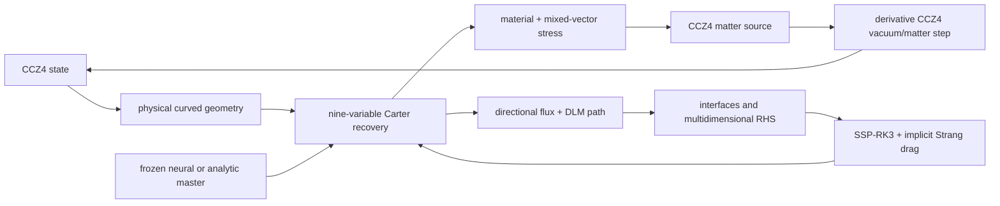

# Vulkan Tesseract

**Turn your gaming PC into a neural spacetime simulator.**

Vulkan Tesseract is a standalone Carter/CCZ4 simulation project built with
Slang, Vulkan, and a float64 Python reference engine. Its resident GPU path
combines hard neural constitutive switching, relativistic two-current matter,
mixed-vector stress, multidimensional conservative transport, implicit
counterflow drag, and dynamical spacetime geometry.

It retains every original Tesseract computational workflow and now has a
qualified resident Vulkan implementation of the complete production solver
stack. That includes the learned-phase `full_carter_roe` Riemann ladder,
complete nine-field physical eigensystem, entropy/tracer extension, DLM path
fluctuation, evolved mixed-Proca fields, FD2/FD4 CCZ4, constrained and
strong-field data, physical boundaries, AMR primitives, and deterministic
restart. The exact execution boundary and evidence are in the
[capability alignment manifest](VULKAN_CAPABILITY_PARITY.md).


## Tesseract Studio

Tesseract Studio is the beginner-facing control room for the solver. It turns
the existing qualified PowerShell campaigns into named, allow-listed presets
with an animated spacetime view, live progress, plain-language status,
estimated time remaining, logs, artifacts, and safe stop/resume controls.
There is no command prompt to operate after setup.

**Advanced Mode** expands the same application into Tesseract Laboratory:
typed experiment design, custom validated launches, exact command previews,
a live Tesseract terminal, streamed runner output, run telemetry, artifact
indexing, qualification matrices, numerical metrics, convergence charts,
provenance, and raw JSON evidence.

For a fresh checkout, double-click **Setup Tesseract Studio** once. Then
double-click:

```text
Launch Tesseract Studio.cmd
```

Or launch it from PowerShell:

```powershell
.\run_tesseract_studio.ps1
```

The browser interface opens locally at `http://127.0.0.1:8765`. Try the
**Full-Stack Visual Tour** first, then **Spacetime Smoke Test**. The
**Twin Black-Hole Collision** preset is the qualified `N=120`, length-3,
500-step production contract and may run for roughly a day. Its checkpoint is
rolling, so ten observation intervals do not create ten separate 153 MB
archives.

See the [Tesseract Studio guide](docs/TESSERACT_STUDIO.md) for the preset
catalog, safety boundary, and developer contract.

### Tesseract Spacetime Observatory

Studio now includes a ground-up WebGPU volume renderer backed by an explicit
scientific visualization data plane. It discovers `.tessviz` scenes, streams
multiresolution Zarr v3 field bricks into coarse/fine GPU textures, maintains
a residency page table, ray marches scalar volumes, overlays MOTS and learned
phase geometry, probes float32 field values, and keeps the source evidence and
coordinate/gauge warning visible.

Export the existing compact puncture checkpoint:

```powershell
.\.venv-slang\Scripts\python.exe .\export_tessviz.py `
  .\runs\vulkan_ccz4_puncture_mots_smoke\final_checkpoint.npz `
  .\runs\observatory\puncture-smoke.tessviz
```

The production puncture preset enables compact live GPU observations at an
independent visualization cadence. These are derived replay frames, not
restart checkpoints, and backpressure may drop them rather than stall the
solver. See the complete [Observatory contract and architecture](docs/TESSERACT_OBSERVATORY.md).

## Current GPU milestone

The resident multidimensional engine advances:

- the curved nine-variable Carter primitive block
  `(log n, s, q_N^i, log d, q_D^i)`;
- the eleven-component conserved block
  `(D_N, D_D, S_i, E, P_i^D, D_N s, D_N Y)`;
- analytic-M1 or digest-locked frozen-neural constitutive response;
- mixed massive-vector energy, momentum, and spatial stress;
- resident evolution of both mixed massive-vector potentials, momenta,
  longitudinal charges, cleaning fields, and derived magnetic fields;
- directional Carter fluxes and the nonconservative DLM path contribution;
- full eleven-field Carter Roe and characteristic WENO5-Z interfaces;
- implicit entropy-producing three-component counterflow drag;
- the packed 31-component CCZ4 geometry and gauge state; and
- the derivative-containing FD2/FD4 CCZ4 vacuum and recovered matter-source
  terms;
- Carter outflow, CCZ4 Sommerfeld/Z4, and mixed-Proca radiative/Gauss
  physical boundaries;
- one- through three-dimensional AMR transfer, reflux, and Gauss projection;
- fp64 periodic CMC, isolated CTT, and TOV construction; and
- complete Carter–Proca–CCZ4 checkpoint/restart; and
- vacuum-only resident puncture CCZ4 evolution with explicit, restartable
  KKT/MOTS branch observations.

One coupled step uses:

1. a projected CCZ4 SSP-RK3 half-step;
2. an implicit Carter drag half-step;
3. multidirectional Carter SSP-RK3 transport;
4. a second implicit drag half-step; and
5. a projected CCZ4 SSP-RK3 half-step.

All stage recovery, constitutive decisions, stress evaluation, interface/RHS
assembly, source solves, and geometry derivatives execute on Vulkan. Python
initializes the run, submits kernels, and performs explicit qualification
readbacks.

This statement applies to the evolving production state and numerical
operators. Neural training, the independent float64 oracle, MPI orchestration,
I/O, and visualization remain host workflows by design; they are retained in
full and are not misrepresented as shader kernels.

## Qualified result

The tracked `8 x 8` frozen-neural campaign reports:

| Quantity | Result |
|---|---:|
| CCZ4 vacuum RHS maximum CPU/GPU error | `2.325e-6` |
| CCZ4 vacuum RHS RMS CPU/GPU error | `2.295e-7` |
| Final curved recovery residual | `2.923e-5` |
| Invalid recoveries | `0` |
| Baryon balance error | `4.074e-8` |
| Carrier balance error | `9.779e-9` |
| Tracer balance error | `2.328e-8` |
| Entropy change | `+1.489e-4` |
| Projected determinant residual | `0` |
| Projected trace-`A` residual | `7.276e-12` |
| Host readbacks during evolution | `0` |

The independent oracle evaluates the same projected float32 state with the
float64 CPU CCZ4 implementation, isolating the device operator from input
roundoff and algebraic projection differences.

See the
[multidimensional evolution report](VULKAN_MULTIDIMENSIONAL_EVOLUTION_REPORT.md)
and tracked
[qualification record](vulkan_multidimensional_results.json).

## Quick start

Vulkan Tesseract currently targets Windows PowerShell and a Vulkan-capable
GPU.

Create the shader environment:

```powershell
python -m venv .venv-slang
.\.venv-slang\Scripts\python.exe -m pip install -r requirements-slang.txt
```

Run the end-to-end multidimensional qualification:

```powershell
.\run_vulkan_multidimensional.ps1
```

Run the short live regression:

```powershell
.\.venv-slang\Scripts\python.exe .\test_vulkan_multidimensional.py
```

Run the visualization dashboard:

```powershell
.\run_visualization.ps1
```

Validate the `N=120`, length-3 puncture/MOTS production contract:

```powershell
.\run_vulkan_puncture_mots.ps1 -PlanOnly
```

Run it with restartable observation snapshots:

```powershell
.\run_vulkan_puncture_mots.ps1 -SaveSnapshots
```

## Vulkan qualification ladder

Each stage has a runnable campaign, tracked JSON evidence, and a focused
report.

| Stage | Command | Report |
|---|---|---|
| Resident analytic-M1 material slice | `.\run_vulkan_theory33.ps1` | [Theory 3.3 port](VULKAN_THEORY33_PORT_REPORT.md) |
| Frozen-neural hard phase tape | `.\run_vulkan_frozen_neural.ps1` | [Frozen-neural port](VULKAN_FROZEN_NEURAL_PORT_REPORT.md) |
| WENO5-Z and positivity limiting | `.\run_vulkan_weno.ps1` | [WENO port](VULKAN_WENO_PORT_REPORT.md) |
| Numerical Carter characteristic basis | `.\run_vulkan_carter_eigensystem.ps1` | [Carter eigensystem](VULKAN_CARTER_EIGENSYSTEM_REPORT.md) |
| Mixed sources, full Carter block, CCZ4 geometry | `.\run_vulkan_full_carter_ccz4.ps1` | [Full Carter/CCZ4](VULKAN_FULL_CARTER_CCZ4_REPORT.md) |
| Coupled multidimensional evolution | `.\run_vulkan_multidimensional.ps1` | [Multidimensional evolution](VULKAN_MULTIDIMENSIONAL_EVOLUTION_REPORT.md) |
| Original learned-phase full-Carter Roe ladder | `.\run_vulkan_original_neural_phase_riemann.ps1` | [Capability parity](VULKAN_CAPABILITY_PARITY.md) |
| Original analytic full-Carter shock ladders | `.\run_vulkan_carter_riemann.ps1` | [Capability parity](VULKAN_CAPABILITY_PARITY.md) |
| Full eleven-field characteristic WENO5-Z | `.\run_vulkan_full_carter_weno.ps1` | [Capability parity](VULKAN_CAPABILITY_PARITY.md) |
| Evolved mixed-Proca subsystem and coupled stack | `.\run_vulkan_mixed_proca.ps1` | [Capability parity](VULKAN_CAPABILITY_PARITY.md) |
| Resident constrained CMC/Picard continuum ladder | `.\run_vulkan_constrained.ps1` | [Capability parity](VULKAN_CAPABILITY_PARITY.md) |
| Retained recurrence AD/BPTT and Theory 3.3 native reverse | `.\run_vulkan_original_workflows.ps1` | [Capability alignment](VULKAN_CAPABILITY_PARITY.md) |
| 128-step, 2D continuum, and 3D frontier | `.\run_vulkan_frontier.ps1` | [Capability alignment](VULKAN_CAPABILITY_PARITY.md) |
| Fourth-order CCZ4 full-stack evolution | `.\run_vulkan_ccz4_fd4.ps1` | [Capability alignment](VULKAN_CAPABILITY_PARITY.md) |
| AMR transfer, reflux, and Gauss projection | `.\run_vulkan_amr.ps1` | [Capability alignment](VULKAN_CAPABILITY_PARITY.md) |
| Physical Carter/CCZ4/Proca boundaries | `.\run_vulkan_boundaries.ps1` | [Capability alignment](VULKAN_CAPABILITY_PARITY.md) |
| fp64 TOV and strong-field resident evolution | `.\run_vulkan_tov.ps1` | [Capability alignment](VULKAN_CAPABILITY_PARITY.md) |
| fp64 isolated CTT constraint solve | `.\run_vulkan_isolated_ctt.ps1` | [Capability alignment](VULKAN_CAPABILITY_PARITY.md) |
| Resident puncture CCZ4 with KKT/MOTS tracking | `.\run_vulkan_puncture_mots.ps1` | [Puncture/MOTS campaign](docs/VULKAN_PUNCTURE_MOTS.md) |
| Exhaustive original-to-Vulkan audit | `.\run_vulkan_parity.ps1` | [Capability alignment](VULKAN_CAPABILITY_PARITY.md) |

The progression reports retain the boundary of each experiment and point to
the later stage that crossed it.

## Architecture



The two engines have distinct roles:

- `tesseract_nr_gpu.slang` and `tesseract_nr/vulkan_backend.py` implement the
  resident float32 production path.
- `tesseract_nr/` provides the transparent float64 oracle used for derivative,
  recovery, eigensystem, conservation, and continuum audits.

Flattened Vulkan grids use x-fastest indexing. One-, two-, and
three-dimensional periodic or physical-boundary domains share the same
shader ABI; inactive directions contribute exactly zero transport and
derivative terms.

See [architecture](docs/ARCHITECTURE.md) and
[CPU oracle contract](docs/NR_PDE_SOLVER.md).

## Repository guide

| Path | Purpose |
|---|---|
| `tesseract_nr_gpu.slang` | Resident Carter recovery, transport, sources, eigensystems, and CCZ4 kernels |
| `tesseract_nr/vulkan_backend.py` | Vulkan buffers, ABI, dispatch, splitting, and snapshots |
| `tesseract_nr/vulkan_boundary.py` | Resident physical and characteristic boundaries |
| `tesseract_nr/vulkan_amr.py` | Resident AMR transfer, reflux, and Gauss projection |
| `tesseract_nr/vulkan_tov.py` | fp64 TOV construction and Cartesian sampling |
| `tesseract_nr/vulkan_ctt.py` | fp64 isolated CTT constraint solve |
| `tesseract_nr/vulkan_frontier.py` | Long-horizon and multidimensional frontier campaigns |
| `tesseract_nr/vulkan_ccz4_vacuum.py` | Vacuum-only resident projected CCZ4 evolution |
| `tesseract_nr/vulkan_mots.py` | Packed Vulkan snapshot bridge and restartable puncture/MOTS observer |
| `tesseract_nr/vulkan_parity.py` | Exhaustive capability and source-identity audit |
| `tesseract_nr/vulkan_validation.py` | Independent CPU/Vulkan qualification campaigns |
| `tesseract_cmc_fp64.slang` | fp64 periodic constrained-data kernels |
| `tesseract_ctt_fp64.slang` | fp64 isolated CTT kernels |
| `tesseract_tov_fp64.slang` | fp64 TOV recurrence kernels |
| `theory33_qualified_frozen.slang` | Generated digest-locked constitutive module |
| `theory33_frozen_variants.json` | Replayable frozen constitutive weights and evidence |
| `run_vulkan_*.py` | Python campaign entry points |
| `run_vulkan_*.ps1` | PowerShell campaign wrappers |
| `test_vulkan_*.py` | Short live Vulkan regressions |
| `vulkan_*_results.json` | Tracked machine-readable evidence |
| `VULKAN_*_REPORT.md` | Scope, measurements, reproduction, and honest boundaries |
| `tesseract_full_stack_visualizer.py` | Neural-spacetime dashboard renderer |
| `tesseract_full_stack_dashboard.png` | Repository dashboard image |
| `export_tessviz.py` | Puncture and full-stack checkpoint scene exporter |
| `tesseract_nr/scene.py` | `tesseract.scene.v1`, Zarr volumes, meshes and worldtubes |
| `tesseract_nr/vulkan_observatory.py` | Bounded resident observation and writer staging |
| `tesseract_studio.py` | Local preset controller, job monitor, and HTTP API |
| `studio/` | Beginner-facing dashboard assets and declarative preset manifests |
| `studio/protocols/` | Typed Advanced Mode experiment and parameter contracts |
| `Launch Tesseract Studio.cmd` | Double-click Windows launcher |
| `docs/` | Vulkan architecture, reproduction, oracle, and publishing guides |

## Validation

CPU-safe repository and oracle checks:

```powershell
python -m pytest tests\nr tests\test_artifacts.py tests\test_studio.py -q
```

All live Vulkan regressions:

```powershell
.\.venv-slang\Scripts\python.exe .\test_vulkan_theory33_solver.py
.\.venv-slang\Scripts\python.exe .\test_vulkan_frozen_neural.py
.\.venv-slang\Scripts\python.exe .\test_vulkan_weno.py
.\.venv-slang\Scripts\python.exe .\test_vulkan_carter_eigensystem.py
.\.venv-slang\Scripts\python.exe .\test_vulkan_mixed_sources.py
.\.venv-slang\Scripts\python.exe .\test_vulkan_full_carter_ccz4.py
.\.venv-slang\Scripts\python.exe .\test_vulkan_multidimensional.py
.\.venv-slang\Scripts\python.exe .\test_vulkan_mots.py
.\run_vulkan_frontier.ps1
.\run_vulkan_ccz4_fd4.ps1
.\run_vulkan_amr.ps1
.\run_vulkan_boundaries.ps1
.\run_vulkan_tov.ps1
.\run_vulkan_isolated_ctt.ps1
.\run_vulkan_original_workflows.ps1
.\run_vulkan_parity.ps1
```

Exact environments, generated artifacts, and campaign commands are listed in
[reproducibility](docs/REPRODUCIBILITY.md).

## Alignment boundary and research frontiers

- The aggregate audit reports full original-project capability alignment.
  See the [machine-backed alignment manifest](VULKAN_CAPABILITY_PARITY.md).
- The resident solver covers periodic and physical-boundary evolution,
  FD2/FD4 geometry, 128-step and 2D/3D campaigns, AMR primitives, fp64
  constrained/TOV setup, strong-field stepping, and complete restart.
- Training, the independent oracle, MPI orchestration, diagnostics, I/O, and
  visualization retain their correct host roles. Multi-GPU Vulkan domain
  decomposition would be a new scaling capability, not an original parity
  gap.
- Device evolution uses float32 and constrained/TOV setup uses fp64 Vulkan
  kernels. Both are qualified against the original float64 oracle.
- Hard constitutive switching is genuinely nonsmooth. Branches remain fixed
  inside Newton/Jacobian solves and are reclassified only between transition
  solves.
- GPU validation requires local Vulkan hardware. Hosted CI performs source,
  artifact, and deterministic CPU-oracle checks.
- Longer and more violent strong-field ladders, higher-order DLM quadrature,
  broader neural shock training, and kinetic/microphysical data are active
  research frontiers rather than unimplemented original capabilities.

## Documentation

- [Documentation index](docs/INDEX.md)
- [Tesseract Studio](docs/TESSERACT_STUDIO.md)
- [Architecture](docs/ARCHITECTURE.md)
- [Reproducibility](docs/REPRODUCIBILITY.md)
- [CPU numerical-relativity oracle](docs/NR_PDE_SOLVER.md)
- [Vulkan puncture/MOTS campaign](docs/VULKAN_PUNCTURE_MOTS.md)
- [Publishing](docs/PUBLISHING.md)
- [Multidimensional evolution report](VULKAN_MULTIDIMENSIONAL_EVOLUTION_REPORT.md)
- [Original-to-Vulkan capability parity](VULKAN_CAPABILITY_PARITY.md)

## Contributing

See [CONTRIBUTING.md](CONTRIBUTING.md). Changes to physical or derivative
paths should identify which hard signatures can change and include an
independent numerical audit.

## Citation

If you use Vulkan Tesseract in research, cite the project using
[CITATION.cff](CITATION.cff).

## License

Vulkan Tesseract is licensed under the
[Apache License 2.0](LICENSE). Attribution information is in
[NOTICE](NOTICE).
