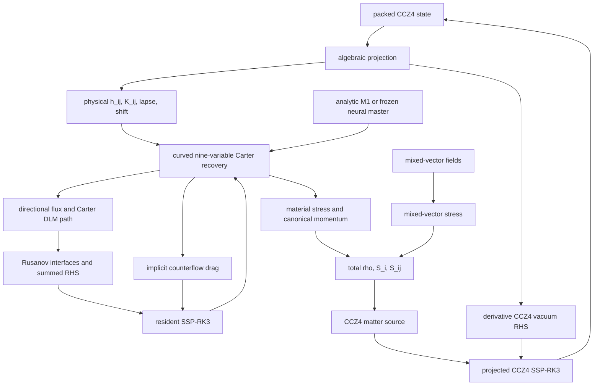

# Vulkan architecture

## Runtime layers

| Layer | File | Role |
|---|---|---|
| Device physics | `tesseract_nr_gpu.slang` | Carter recovery, constitutive response, stress, transport, sources, eigensystems, and CCZ4 |
| Device control | `tesseract_nr/vulkan_backend.py` | Resident buffers, dispatch graph, splitting, initialization, and explicit snapshots |
| CPU oracle | `tesseract_nr/` | Independent float64 geometry, matter, recovery, transport, and diagnostics |
| Qualification | `tesseract_nr/vulkan_validation.py` | CPU/GPU comparisons and tracked acceptance gates |
| Frozen closure | `theory33_qualified_frozen.slang` | Digest-locked learned constitutive inference |

## Coupled dataflow



## Resident state contracts

### Carter primitive

```text
log n, s, q_N_x, q_N_y, q_N_z,
log d, q_D_x, q_D_y, q_D_z
```

### Carter conserved

```text
D_N, D_D, S_x, S_y, S_z, E,
P_D_x, P_D_y, P_D_z, D_N*s, D_N*Y
```

### CCZ4

```text
gt_ij, At_ij, phi, K, theta, GammaHat_i,
alpha, beta_i, B_i
```

Both tensor blocks are row-major. Flattened spatial grids are x-fastest:

```text
point = x + nx * (y + ny * z)
```

Inactive dimensions have extent one and contribute zero spatial derivatives.

## Curved recovery

The recovery kernel subtracts the geometry-dependent vector energy and
momentum from the total conserved state, then solves the nine material
unknowns with:

- scaled centered finite-difference Jacobians;
- a pivoted `9 x 9` linear solve;
- backtracking line search;
- density and entropy guards; and
- branch-frozen neural constitutive evaluation.

Hard phase decisions are constant inside a Newton solve. The classifier is
re-evaluated only between transition solves. Recovery diagnostics include
the scaled residual, validity, phase crossings, active phase, switching
margin, recovered entropy/tracer, and geometry validity.

## Transport

For every active direction, the device evaluates:

1. curved Carter material flux;
2. mixed-vector energy, momentum, and stress contributions;
3. entropy and tracer transport;
4. canonical-momentum DLM path data;
5. a coordinate characteristic-speed bound;
6. periodic Rusanov face fluxes; and
7. directional flux divergence plus midpoint path source.

Directional RHS buffers are summed after all face passes. The current full
curved interface uses the robust Rusanov baseline. Component and restricted
characteristic WENO kernels remain available as qualified earlier layers.

## Local sources

Mixed-vector stress is evaluated in independent A/B passes before the device
combine pass, avoiding temporary-array aliasing on Vulkan drivers.

The implicit drag kernel holds material number densities and energy-momentum
fixed while exponentially relaxing `q_D^i - q_N^i`. Dissipated counterflow is
converted into entropy. The evolved specific tracer is extracted from the
resident conserved state before recomposition.

## CCZ4 operator

The packed geometry kernel supplies:

- conformal determinant and tracefree projection;
- physical metric and extrinsic-curvature reconstruction;
- physical and conformal Christoffel symbols;
- physical Ricci tensor and scalar;
- lapse Hessian and covariant Laplacian;
- `Z_i`, `D_i Z_j`, and `div Z`;
- Lie/advection terms;
- 1+log or harmonic slicing;
- Gamma-driver shift evolution;
- `kappa1`, `kappa2`, and `kappa3` damping; and
- full Eulerian Carter matter sources.

Spatial derivatives are periodic centered FD2 in the current coupled
qualification.

## Time scheduling

`VulkanTesseractCoupledBackend.step` applies a symmetric outer split:

```text
CCZ4(dt/2) -> Carter(dt) -> CCZ4(dt/2)
```

The Carter step contains its own symmetric stiff-source split:

```text
drag(dt/2) -> SSP-RK3 transport(dt) -> drag(dt/2)
```

CCZ4 SSP-RK3 stages are algebraically projected before the following RHS
evaluation. Curved matter recovery and total stress are refreshed at every
geometry stage.

## Readback boundary

Evolution methods retain device tensors and do not call `to_numpy`.
Readbacks occur only through explicit snapshot or qualification methods. The
tracked multidimensional campaign asserts zero host reads during evolution.

## Independent oracle

The CPU backend does not emulate shader implementation details. It evaluates
the physical equations in float64 and supplies:

- primitive and drag references;
- full Carter principal symbols and eigensystems;
- mixed-vector stress;
- CCZ4 geometry, derivatives, and matter sources;
- conservation and continuum diagnostics; and
- cellwise hard-phase comparisons.

This separation makes CPU/GPU agreement evidence rather than shared-code
self-consistency.
